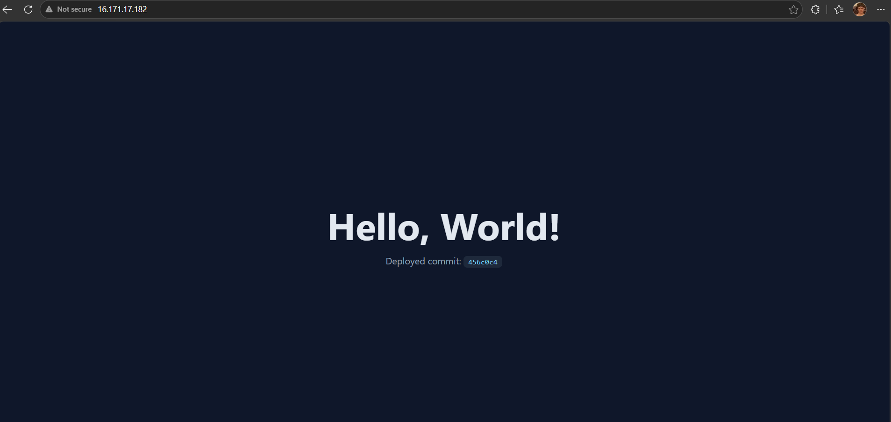
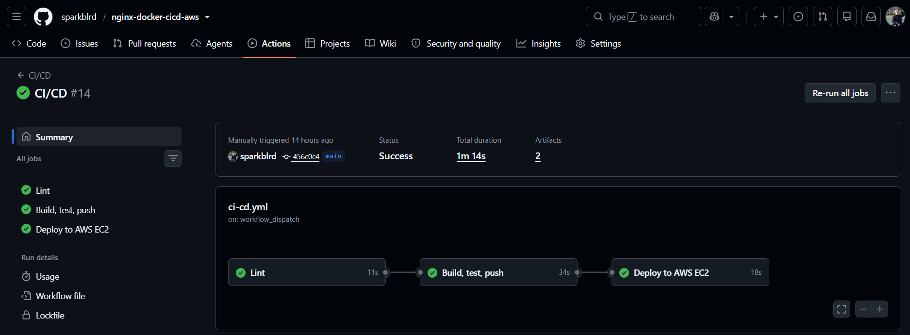
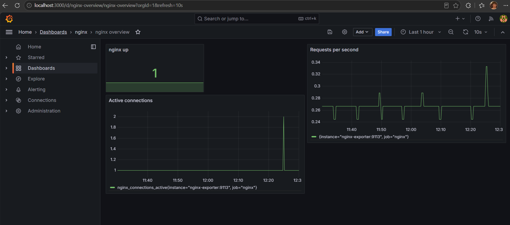

# nginx-docker-cicd-aws

A "Hello, World!" web app served by **Nginx** in a **Docker** container. A **GitHub Actions** pipeline lints, builds, tests and publishes the image to **Docker Hub**, then deploys it to an **AWS EC2** server on every push to `main`.

**Live:** `http://16.171.17.182/`



## How it works

```
git push → GitHub Actions → Docker Hub → AWS EC2
           (lint, build, test, push, deploy over SSH, smoke test)
```

| Event | Pipeline |
|---|---|
| Pull request to `main` | lint, build, container tests (no push, no deploy) |
| Push to `main` | lint, build, test, push image, deploy, smoke test |

- Images are tagged with the git SHA (and `latest`); deploys always use the SHA tag.
- `deploy.sh` runs on the server: pulls the image, restarts the container, waits for `healthy`, and **rolls back** to the previous version if it fails.
- The smoke test checks that the public `/version.txt` equals the deployed commit.

## Repository layout

```
app/index.html                the web app
nginx/default.conf            Nginx config (JSON logs, /healthz)
Dockerfile                    nginx-unprivileged, non-root, HEALTHCHECK
docker-compose.yml            runs the container on the server
scripts/build.sh              manual build/push
scripts/deploy.sh             server-side deploy with rollback
scripts/bootstrap-server.sh   one-time server setup
.github/workflows/ci-cd.yml   the pipeline
```

## Run locally

```bash
IMAGE=local/nginx-docker-cicd-aws ./scripts/build.sh
docker run --rm -p 8080:8080 local/nginx-docker-cicd-aws:latest
```

Open http://localhost:8080 (health check: `/healthz`).

## Setup

**1. EC2.** Launch Ubuntu 24.04, `t3.micro`, in a **public subnet** with *auto-assign public IP* enabled (custom VPC: attach an Internet Gateway and add route `0.0.0.0/0 → igw`). Security group inbound: **80** and **22** from `0.0.0.0/0`. Create a key pair for admin access.

**2. CI SSH key** (keep it outside the repo):

```bash
ssh-keygen -t ed25519 -f ~/.ssh/ci_deploy_key -N "" -C "ci-deploy"
```

**3. Prepare the server** (installs Docker, creates the `deploy` user, installs the CI public key):

```bash
ssh -i <admin-key>.pem ubuntu@<EC2_PUBLIC_IP>
curl -fsSLO https://raw.githubusercontent.com/<GITHUB_USER>/nginx-docker-cicd-aws/main/scripts/bootstrap-server.sh
sudo CI_PUBLIC_KEY="$(paste contents of ci_deploy_key.pub)" bash bootstrap-server.sh
```

Check from your machine: `ssh -i ~/.ssh/ci_deploy_key deploy@<EC2_PUBLIC_IP> docker ps`.

**4. Docker Hub.** Create a **public** repository `nginx-docker-cicd-aws` and an access token with **Read & Write**.

**5. GitHub** → Settings → Secrets and variables → Actions:

| Tab | Name | Value |
|---|---|---|
| Variables | `DOCKERHUB_USERNAME` | Docker Hub username |
| Secrets | `DOCKERHUB_TOKEN` | Docker Hub token |
| Secrets | `SSH_HOST` | server public IP |
| Secrets | `SSH_USER` | `deploy` |
| Secrets | `SSH_PRIVATE_KEY` | full contents of `~/.ssh/ci_deploy_key` (with BEGIN/END lines) |
| Secrets | `SSH_KNOWN_HOSTS` | output of `ssh-keyscan -H <EC2_PUBLIC_IP>` |

**6. Run.** Push to `main` (or Actions → CI/CD → *Run workflow*). When all jobs are green, open `http://<EC2_PUBLIC_IP>/`.



## Verify

Change the text in `app/index.html`, push, and wait for the pipeline. The page updates and shows the new commit SHA. You can also check:

```bash
curl http://<EC2_PUBLIC_IP>/healthz        # ok
curl http://<EC2_PUBLIC_IP>/version.txt    # deployed commit SHA
```

**Manual deploy / rollback** (on the server, as `deploy`):

```bash
cd ~/app
IMAGE=<DOCKERHUB_USER>/nginx-docker-cicd-aws TAG=<git-sha> bash deploy.sh
```

Logs (JSON, rotated by Docker): `docker logs -f nginx-docker-cicd-aws`.

## Troubleshooting

| Symptom | Fix |
|---|---|
| `error in libcrypto` / `Permission denied (publickey)` | `SSH_PRIVATE_KEY` is incomplete or doesn't match the public key in `/home/deploy/.ssh/authorized_keys` |
| `Host key verification failed` | Refresh `SSH_KNOWN_HOSTS` with `ssh-keyscan -H <IP>` (e.g. after recreating the server) |
| SSH step times out | Wrong `SSH_HOST`, port 22 closed, or subnet has no Internet Gateway route |
| `Username required` / `Password required` on Docker login | `DOCKERHUB_USERNAME` must be under **Variables**, `DOCKERHUB_TOKEN` under **Secrets** |
| Deploy is green but the site won't open | Port 80 closed in the security group |

## Security notes

Non-root container with all capabilities dropped, pinned base image, key-only SSH with a dedicated `deploy` user, secrets only in GitHub Secrets. Trade-off: port 22 is open to the world because GitHub runners have no fixed IPs; production should use a self-hosted runner or AWS SSM instead.

## Monitoring and logging

The `monitoring/` stack contains nginx-prometheus-exporter, Prometheus and Grafana.

    nginx :8081/stub_status (internal only)
      -> nginx-exporter :9113 -> Prometheus :9090 -> Grafana :3000 (127.0.0.1 only)

Start it on the server after the application is deployed (the `monitoring` network is created by the app's compose file):

    cd ~/monitoring
    read -s -p "Grafana admin password: " GPASS; echo
    printf "GRAFANA_ADMIN_PASSWORD=%s\n" "$GPASS" > .env
    chmod 600 .env && unset GPASS
    sudo docker compose up -d

Open Grafana through an SSH tunnel from your machine:

    ssh -i <key> -N -L 3000:localhost:3000 ubuntu@<SERVER_IP>

Then open http://localhost:3000, log in as `admin` and open the "nginx overview" dashboard.

The monitoring stack is deployed manually, CI does not deploy it.



### Logging

nginx writes JSON access logs to stdout:

    docker logs nginx-docker-cicd-aws --tail 20

## Kubernetes

The `k8s/` directory contains manifests for running the same image on a cluster:

- `deployment.yaml`: 2 replicas, readiness and liveness probes on `/healthz`, CPU and memory requests and limits, non-root user (UID 101), read-only root filesystem with `emptyDir` volumes for `/tmp` and the nginx cache, all capabilities dropped.
- `service.yaml`: ClusterIP service on port 80.
- `kustomization.yaml`: sets the image tag in one place.

Try it locally with kind:

```bash
kind create cluster --name nginx-cicd
kubectl apply -k k8s
kubectl rollout status deployment/nginx-docker-cicd-aws
kubectl port-forward svc/nginx-docker-cicd-aws 8080:80
curl -i http://localhost:8080/healthz
```

The manifests are validated against Kubernetes 1.31 by kubeconform in the `k8s-validate` workflow. The cluster was tested on kind, not on the EC2 instance. A t3.micro with 1 GB RAM is too small to run a control plane next to the other containers.

## Project scope

| Task | Status |
|---|---|
| Dockerfile for an nginx web app | Done |
| Build and deploy scripts | Done |
| CI/CD on every commit (GitHub Actions) | Done |
| Monitoring and logging | Done: nginx stub_status, Prometheus, Grafana, JSON access logs |
| Kubernetes manifests | Done: Deployment, Service, Kustomize, validated in CI, tested on kind |
| Terraform | Not implemented |

Security notes: the server's SSH port is open to the internet for GitHub-hosted runners, and access is key-only. Grafana listens on 127.0.0.1 and is reachable only through an SSH tunnel. The metrics endpoint is not published outside the Docker network.
